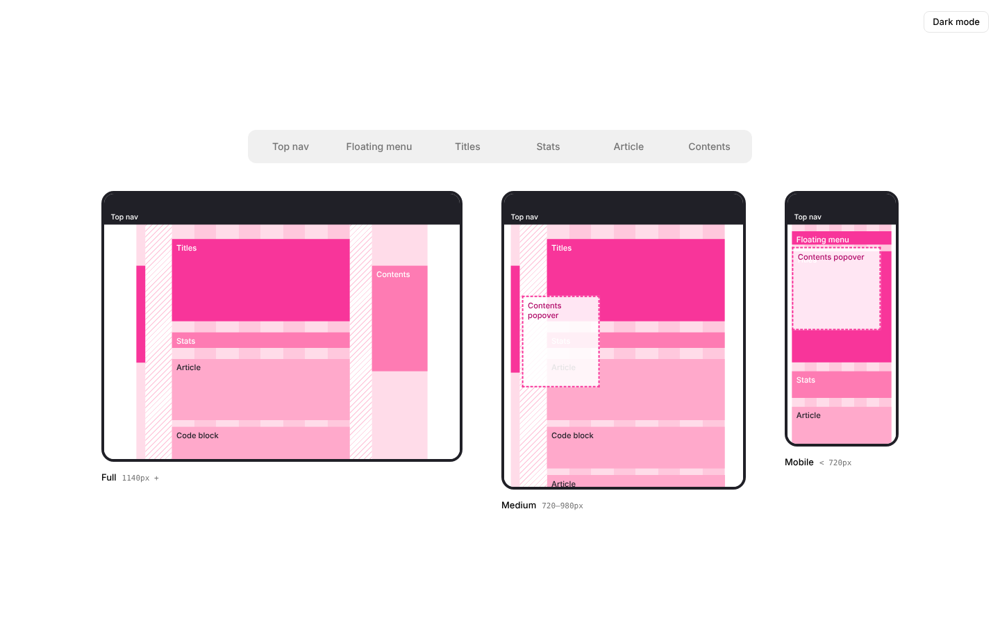
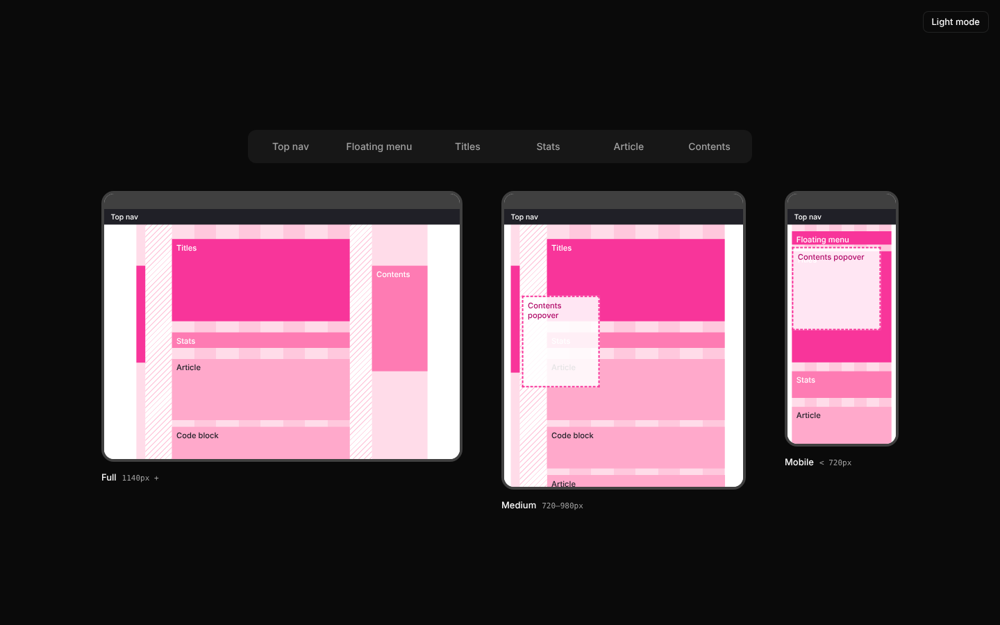

# Responsive Layout Map

A React component that draws a page's layout at several breakpoints side by side, all to the same scale. Pick a block (Top nav, Floating menu, Titles…) to highlight it in every frame and see how it moves between Full, Medium and Mobile.

It ships with the layout of a docs-style home page, and you can feed it your own.

**[Live demo →](https://tanaka-1997.github.io/responsive-layout-map/)**

<p>
  
  
</p>

## What it shows

| Breakpoint | Range | Layout |
| --- | --- | --- |
| **Full** | 1140px + | Three columns: floating menu, article, contents. Gaps of 96 and 80 px, wrap fixed at 1048 px and centred. |
| **Medium** | 720–980px | Contents sidebar removed; contents opens as a popover from the menu. Article centres in the remaining space. |
| **Mobile** | < 720px | The menu becomes a toolbar pinned under the nav. Article fills the width with 16 px margins; popovers open below the toolbar. |

Columns are drawn as pink stripes and gutters as hatching, so you can see the 8-column grid behind each frame.

## Usage

```jsx
import { ResponsiveLayoutMap } from "responsive-layout-map";

export function LayoutDocs() {
  return <ResponsiveLayoutMap />;
}
```

Install straight from GitHub:

```bash
npm install github:tanaka-1997/responsive-layout-map
```

Your bundler needs to handle JSX and CSS imports (Vite, Next.js and similar do this out of the box).

## Props

| Prop | Type | Default | Description |
| --- | --- | --- | --- |
| `breakpoints` | `Breakpoint[]` | Home page (Full, Medium, Mobile) | The frames to draw. See [Your own layout](#your-own-layout) |
| `blockTypes` | `Record<string, BlockType>` | Home page blocks | Names and colours of each kind of block; also the order of the buttons |
| `scale` | `number` | `0.4` | Largest scale to draw the frames at |
| `fit` | `boolean` | `true` | Shrink to fit the container. On narrow screens the frames stack vertically |
| `minRowScale` | `number` | `0.2` | Below this scale, frames stack instead of sitting side by side |
| `focus` | `string \| null` | — | Controlled highlighted block type. Leave unset to let the component manage it |
| `defaultFocus` | `string \| null` | `null` | Block type highlighted on first render |
| `onFocusChange` | `(type: string \| null) => void` | — | Called when the highlighted block changes |
| `showControls` | `boolean` | `true` | Show the row of block buttons |
| `className` | `string` | — | Extra class on the root element |

## Your own layout

Each breakpoint is a size plus the blocks drawn inside it, in real CSS pixels at that width. The component scales everything down.

```jsx
const blockTypes = {
  header: { label: "Header", color: "var(--rlm-ink)" },
  hero: { label: "Hero", color: "var(--rlm-p1)" },
  cards: { label: "Cards", color: "var(--rlm-p3)", darkText: true },
};

const breakpoints = [
  {
    name: "Desktop",
    width: 1280,
    height: 800,
    range: "1024px +",
    layout: {
      blocks: [
        { type: "header", x: 0, y: 0, w: 1280, h: 64, label: "Header" },
        { type: "hero", x: 120, y: 112, w: 1040, h: 360, label: "Hero" },
        { type: "cards", x: 120, y: 504, w: 1040, h: 240, label: "Cards" },
      ],
      columns: [], // optional: { x, w, alt } stripes behind the blocks
      gutters: [], // optional: { x, w } hatched areas
    },
  },
  // …more breakpoints
];

<ResponsiveLayoutMap breakpoints={breakpoints} blockTypes={blockTypes} />;
```

Set `popover: true` on a block to draw it as a dashed overlay. The home-page data lives in `src/homePageLayout.js` if you want a fuller example.

## Theming

All colours are CSS custom properties scoped to `.rlm`, so you can override them without touching the stylesheet:

```css
.rlm {
  --rlm-p1: oklch(0.6 0.2 260);  /* strongest block colour */
  --rlm-p2: oklch(0.7 0.15 260);
  --rlm-p3: oklch(0.82 0.1 260);
  --rlm-p4: oklch(0.93 0.04 260); /* columns */
  --rlm-ink: #1b1b22;             /* frame and nav colour */
}
```

Dark mode switches on when `.dark` is on the component or any ancestor. The frames stay light because they picture a light page.

## Accessibility

Block buttons report whether they're selected, each frame has a text label with its name and range, the controls show a focus ring for keyboard users, and transitions turn off for people who've asked for reduced motion.

## Development

```bash
npm install
npm run dev     # demo at localhost:5173
npm run build   # builds the demo into dist/
```

The demo deploys to GitHub Pages on every push to `main`.

## Licence

MIT
